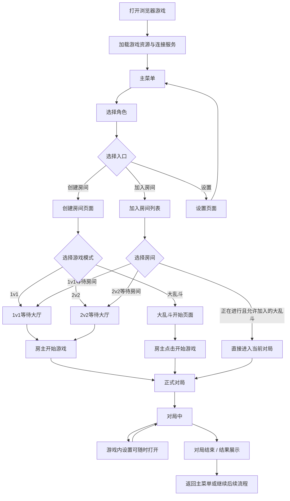

# 01｜整体游戏流程与交互逻辑

> 状态：整体流程初稿，页面细节分别见 02—05 号文档
> 适用平台：浏览器桌面端网页游戏
> 文档职责：描述玩家从打开游戏、进入主菜单、创建或加入房间、进入对局到结束对局的完整产品流程。具体页面布局和控件细节以对应页面 PRD 为准。

## 1. 产品体验目标

玩家打开浏览器进入游戏后，应能快速理解游戏入口，并通过创建房间或加入房间开始游玩。整个流程尽量直接，不加入当前未规划的等级、经验、商城或复杂成长系统。

- 平台：桌面浏览器中的网页游戏，不按手机横屏 UI 设计。
- 核心模式：1v1、2v2、大乱斗。
- 核心入口：主菜单中的创建房间、加入房间和设置。
- 角色：四个原创角色；主菜单可选择角色，进入等待房间后在开局前仍可按规则调整。
- 设置：鼠标灵敏度、准星、声音与音效；准星等战斗相关设置在对局中也能打开调整。

## 2. 全局页面与流程图

## 3. 主菜单阶段

1. 玩家打开游戏，完成必要的资源加载与服务连接。
2. 成功进入主菜单。
3. 主菜单展示玩家头像、可编辑昵称、四个可选角色，以及创建房间、加入房间和设置入口。
4. 玩家点击角色即可选择；奶酪标记移动到所选角色脚下，所选角色同步放大。
5. 当前选中的角色作为后续创建或加入房间时使用的角色。
6. 玩家可从主菜单打开设置；设置保存后返回主菜单。

主菜单视觉、角色选择动画和控件细节见 02《主菜单页面 PRD》。

## 4. 创建房间流程

1. 玩家在主菜单选择角色后点击创建房间。
2. 进入创建房间页面，选择 1v1、2v2 或大乱斗。
3. 1v1：创建者成为房主，进入两个玩家席位的等待大厅；其他玩家加入后自动视为准备完成；只有房主显示开始游戏按钮。
4. 2v2：创建者成为房主，进入蓝队和红队各两个席位的等待大厅；玩家开局前可以切换队伍；只有房主显示开始游戏按钮。
5. 大乱斗：不进入等待玩家大厅；房主点击开始游戏后直接进入对局。

页面与交互细节见 03《创建房间页面与三种模式交互》。

## 5. 加入房间流程

1. 玩家在主菜单点击加入房间。
2. 进入房间列表，浏览房间名称、模式、人数和状态；可搜索或刷新。
3. 玩家查看房间详情并执行加入。
4. 加入 1v1 等待房间：进入 1v1 等待大厅。
5. 加入 2v2 等待房间：进入 2v2 等待大厅，可在开局前切换队伍。
6. 加入正在进行且允许中途加入的大乱斗房间：直接进入该场对局，不经过等待大厅。
7. 房间已满、已关闭或状态已变化时，阻止加入并给出清晰提示。

页面与交互细节见 04《加入房间页面与加入流程设计》。

## 6. 等待大厅与开局权限

- 1v1 和 2v2 才存在等待玩家的大厅流程。
- 玩家加入 1v1 或 2v2 房间后自动视为准备完成，不需要准备按钮。
- 1v1 的两个玩家席位分别展示房主和加入玩家。
- 2v2 的蓝队、红队各两个席位；每位玩家可在开局前切换阵营，切换后头像与昵称移动到另一队空位。
- 只有房主可以开始 1v1 或 2v2 对局；普通玩家不显示开始游戏按钮。
- 大乱斗房主不等待其他玩家，点击开始游戏即进入对局；其他玩家从房间列表加入正在进行的房间后直接进入。
- 角色在等待阶段可以按页面规则调整；正式对局开始后锁定本局角色。

## 7. 对局阶段

- 玩家进入正式游戏画面后开始本局对战。
- 对局中提供可访问的设置入口，至少可调整鼠标灵敏度、准星和声音 / 音效。
- 设置面板不能遮挡关键战斗信息；设置的即时生效方式和是否暂停本地输入由设置 PRD 与技术实现共同确定。
- 对局核心玩法、胜负条件、计分和重生规则需由独立玩法规则确认；本文不凭空定义数值或胜负条件。

## 8. 对局结束阶段

- 对局结束后进入结果展示状态，明确告知玩家本局已结束。
- 结果页的具体信息、按钮和后续动作需结合胜负规则进一步设计。
- 预期后续入口包括返回主菜单，以及在规则允许时再次开始 / 返回房间；最终以单独的结算流程设计为准。
- 不应在结果展示阶段误触发新一局。

## 9. 全局异常与返回原则

- 加载失败或服务连接失败：显示可理解的错误状态和重试方式。
- 创建 / 加入失败：保留玩家当前角色选择，并提供返回或重试。
- 房间状态变化：以服务端最新状态为准，不能仅依赖过期列表信息。
- 玩家离开房间、房主离开、断线重连和对局中断的具体规则，需结合现有房间系统另行确认。
- 各页面应提供明确的返回或离开入口，避免玩家陷入无法退出的页面。

## 10. 文档分工

| 编号 | 文档 | 负责内容 |
|---|---|---|
| 01 | 整体游戏流程与交互逻辑 | 全局页面关系、玩家完整流程、模式分支、开局与结束流程 |
| 02 | 主菜单页面 PRD | 主菜单布局、角色选择、奶酪标记动画、玩家信息和入口 |
| 03 | 创建房间页面与三种模式交互 | 创建房间、1v1 / 2v2 等待大厅、大乱斗开始流程 |
| 04 | 加入房间页面与加入流程设计 | 房间列表、搜索、详情、加入不同模式的流程 |
| 05 | 游戏内设置页面 PRD | 鼠标、准星、声音与音效设置及游戏内访问方式 |

## 11. 待后续明确

1. 对局胜负条件、回合 / 时间规则、结算内容与再来一局流程。
2. 房主离开、普通玩家离开、断线重连和房间销毁规则。
3. 大乱斗中途加入的人数上限和加入时间限制。
4. 具体服务连接失败、创建失败和加入失败的错误分类。

本文件定义全局流程，不替代各页面 PRD，也不代表功能已经开发完成。