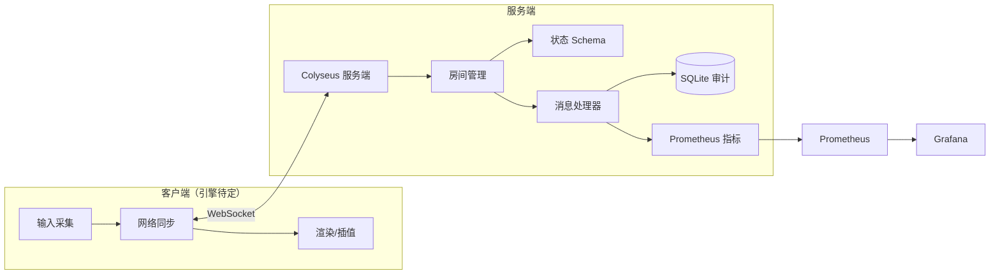

# 01 · 系统架构设计

> **状态：大纲占位（🟡）** —— 本文件已确定章节结构与写作要求，正文待开发过程中逐节填充。
> 对应论文章节：**第 3 章 系统设计**。

---

## 1. 文档目标

说明整个系统的模块划分、数据流与关键设计决策，回答三个问题：

1. 服务端如何组织才能保证状态权威与可扩展性？
2. 客户端与服务端之间同步什么、如何同步？
3. 安全增强模块（审计 / 日志 / 监控）如何以低侵入方式接入主流程？

---

## 2. 总体架构（待填充）

> 填充要求：一张分层架构图（建议 Mermaid）+ 一段 300 字说明。
> 分层自下而上：存储层 → 服务层（Colyseus 房间）→ 网络层（WS）→ 客户端层。

**填充位置**：`## 2. 总体架构（待填充）` 正下方。

---

## 3. 服务端模块划分（待填充）

| 目录 | 职责 | 关键类/文件（待定） |
| --- | --- | --- |
| `src/rooms/` | 房间生命周期、`onCreate/onJoin/onLeave/onDispose` | `fps-battle-room.ts` |
| `src/state/` | Colyseus Schema 定义（玩家、房间、对局） | `player.ts` `battle-state.ts` |
| `src/handlers/` | 按消息类型拆分的处理逻辑 | `move.ts` `shoot.ts` `hit.ts` |
| `src/config/` | 环境变量加载 + schema 校验 | `index.ts` |
| `src/audit/` | SQLite 审计写入、查询、清理 | `audit-repository.ts` |
| `src/monitoring/` | prom-client 指标注册与暴露 | `metrics.ts` |
| `src/utils/` | 日志、限流、校验、时间工具 | `logger.ts` `rate-limiter.ts` |

**填充位置**：每实现完一个模块，回来补齐“关键类/文件”列并补充 100–200 字设计说明。

---

## 4. 网络同步设计（待填充）

> 待决策项（原型阶段需给出对比结论，写入本小节）：
> - 状态同步方式：Colyseus Schema 增量同步 vs 自定义快照
> - 发送频率：固定 20Hz 广播 vs 按事件触发
> - 客户端预测：是否做移动预测 + 服务端回滚校验（lag compensation）
> - 命中判定：服务端权威 raycast vs 客户端上报 + 服务端校验

**填充位置**：`## 4. 网络同步设计（待填充）` 正下方，需包含时序图（玩家开火 → 服务端校验 → 广播结果）。

---

## 5. 数据模型（待填充）

> 需给出两类模型：
> 1. **内存状态模型**：玩家（id / 位置 / 朝向 / 血量 / 武器 / 队伍）、对局（阶段 / 计时 / 比分）
> 2. **审计表模型**：见 `04-security-audit.md` 第 4 节

**填充位置**：本小节，附 ER 图或表格。

---

## 6. 安全增强在架构中的位置（待填充）

- 审计：以**中间件/钩子**形式挂在消息处理器入口，异步批量写 SQLite，不阻塞主循环。
- 日志：统一 Pino 实例，按 `traceId / roomId / playerId` 打标。
- 监控：独立 HTTP 服务暴露 `/metrics`，与游戏端口分离（`METRICS_PORT`）。

**填充位置**：本小节，补充一张“安全组件挂载点”示意图。

---

## 7. 关键设计决策记录（ADR）

| 编号 | 决策 | 备选方案 | 结论 | 状态 |
| --- | --- | --- | --- | --- |
| ADR-001 | 状态同步用 Colyseus Schema | 自研二进制协议 | 待定 | 🟡 |
| ADR-002 | SQLite 做审计存储 | MySQL / 日志文件 | 待定（倾向 SQLite，零部署） | 🟡 |
| ADR-003 | Docker 仅用于监控组件 | 全容器化 | 已定：仅监控 | ✅ |
| ADR-004 | 客户端渲染引擎 | Three.js / Babylon.js / PlayCanvas | 原型阶段确定 | 🟡 |

---

## 8. 待办清单

- [ ] 填充第 2 节总体架构图与说明
- [ ] 确定网络同步方案并写第 4 节
- [ ] 补充审计表结构（联动 `04-security-audit.md`）
- [ ] 完成 ADR-001 / ADR-002 / ADR-004 的结论
